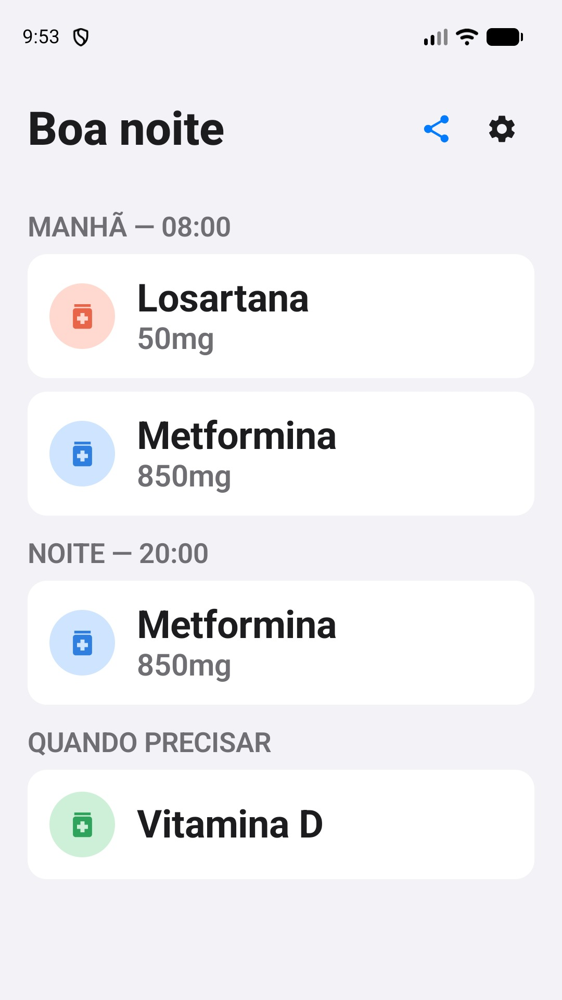
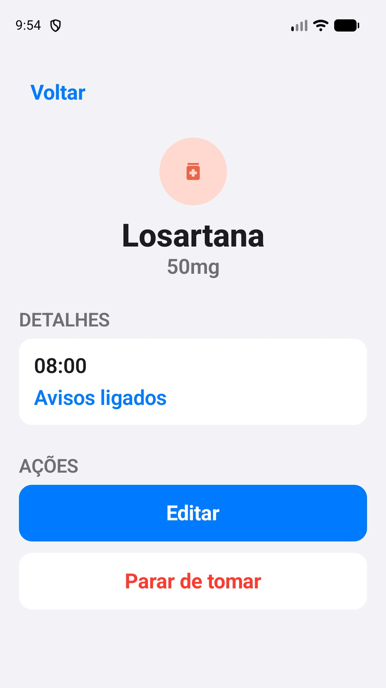
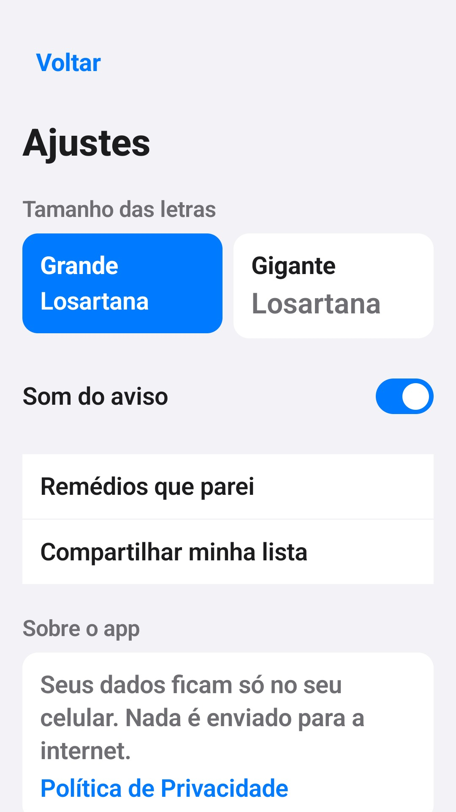

# Hora do Remédio (Android)

Lembrete de remédios para idosos: cadastra o remédio, a dose e o horário, e o app avisa na hora certa, sem conta, sem login e sem internet.

Este é o port nativo Android (Kotlin + Jetpack Compose) do app iOS [Hora do Remédio](https://github.com/asiqueira1973/hora-do-remedio), que está publicado na [App Store](https://apps.apple.com/br/app/ta-na-hora-do-rem%C3%A9dio/id6795346505). A proposta de produto e os textos são os mesmos; cada plataforma usa as suas primitivas nativas.

<p>
  
  
  
</p>

## Principais funcionalidades

- Cadastro de remédio com nome, dose, forma, frequência (todo dia, dias da semana ou quando precisar), horários, observação e cor.
- Tela principal com os remédios ativos agrupados por horário.
- Lembretes locais com `AlarmManager`, reagendados depois de reiniciar o aparelho.
- Fluxo explicativo para pedir as permissões de notificação e de alarme exato.
- Arquivar ("parar de tomar") com opção de desfazer, e voltar a tomar depois.
- Exportação da lista como texto pelo compartilhamento do Android.
- Ajustes de tamanho de letra (grande / gigante), som do aviso e apagar todos os dados.
- 100% offline: os dados ficam só no aparelho, em SQLite.

## Stack técnica

- Kotlin, Jetpack Compose, Material Design 3 (cores fixas, sem dynamic color)
- Room (SQLite), com CHECK, FK e triggers criados em SQL bruto
- `AlarmManager` + `BroadcastReceiver` para os lembretes (sem servidor, sem push)
- Navigation Compose (single-activity)
- JUnit (testes JVM) e AndroidX Test (testes instrumentados)
- `minSdk 26`, `targetSdk 35`, só telefone, só retrato

## Como foi construído

O app foi desenvolvido com Claude (Anthropic) a partir de especificações no formato SDD. A [`spec.md`](spec.md) deste repositório é a spec do port: ela traduz para Android a spec do app iOS ([`spec-ios.md`](spec-ios.md)), mantendo o comportamento e mudando só a tecnologia. O sistema como foi implementado, com as divergências entre as plataformas, está em [`DOCUMENTACAO-TECNICA.md`](DOCUMENTACAO-TECNICA.md).

O que existe no repositório para manter a qualidade:

- [`CLAUDE.md`](CLAUDE.md) com o guia para o agente de código: comandos, arquitetura, convenções e as "pegadinhas" que não podem ser quebradas (bugs reais já encontrados e corrigidos).
- Testes unitários JVM (`app/src/test/`) para as funções puras: cálculo de agendamento, agrupamento da tela principal e geração do texto exportado (comparação literal com o formato da spec).
- Testes instrumentados (`app/src/androidTest/`) que validam CHECK, FK, UNIQUE e triggers no SQLite real, que o Room não verifica sozinho.

## Status

Em desenvolvimento. Segundo o `CLAUDE.md`, o app foi enviado para revisão na Google Play; ainda não há link público da loja.

## Como rodar

### Pré-requisitos

- JDK 21 (o Android Gradle Plugin não builda com JDK 25+).
- Android SDK (as command-line tools bastam). `local.properties` aponta `sdk.dir` para a instalação local e não é versionado; se não existir, crie com uma linha `sdk.dir=<caminho do Android SDK>`.
- Um emulador ou aparelho Android 8.0+ (API 26+).

### Build e execução

```bash
export JAVA_HOME=<caminho do JDK 21>
export ANDROID_HOME=<caminho do Android SDK>

./gradlew :app:assembleDebug
./gradlew installDebug
adb shell am start -n com.dablab.horadoremedio.debug/com.dablab.horadoremedio.MainActivity
```

### Testes

```bash
./gradlew test                        # testes unitários JVM
./gradlew connectedDebugAndroidTest   # testes instrumentados (precisa de emulador ou aparelho)
./gradlew lint                        # lint Android
```

### Build de release

A assinatura lê um `keystore.properties` na raiz do repositório (não versionado):

```properties
storeFile=/caminho/para/upload.jks
storePassword=...
keyAlias=...
keyPassword=...
```

Sem esse arquivo, `./gradlew bundleRelease` gera um build sem assinatura (útil em desenvolvimento, não publicável).

### Estrutura do projeto

```
app/src/main/java/com/dablab/horadoremedio/
├── dados/          # Room: entidades, DAOs, AppDatabase, Repositorio
├── lembretes/      # AlarmManager: cálculo de agendamento, agendador, receivers, notificações
├── designsystem/   # cores, tipografia, tema Material 3
├── exportacao/     # geração e compartilhamento da lista em texto
└── telas/          # uma pasta por tela; RootView.kt como roteador raiz
```

`spec-ios.md`, `DOCUMENTACAO-TECNICA-ios.md` e `SCHEMA-ios.md` são cópias de referência do projeto iOS, só para consulta.

## Licença

O código está disponível apenas para leitura e estudo. Veja [LICENSE](LICENSE).

## Contribuições

Issues são bem-vindas; pull requests não são aceitos. Veja [CONTRIBUTING.md](CONTRIBUTING.md).

---

Feito pela [Dab Lab](https://www.dablab.com.br/) — product studio de software e IA que constrói apps para pequenas empresas, startups e áreas dentro de grandes empresas, partindo de uma especificação (Spec-Driven Development) e com as disciplinas de engenharia de software robusta.
